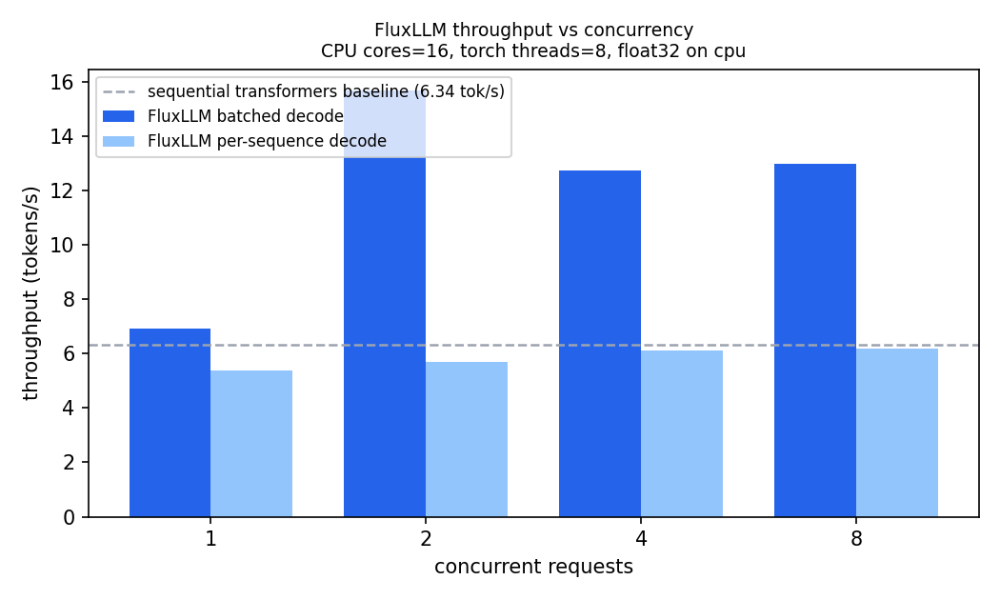
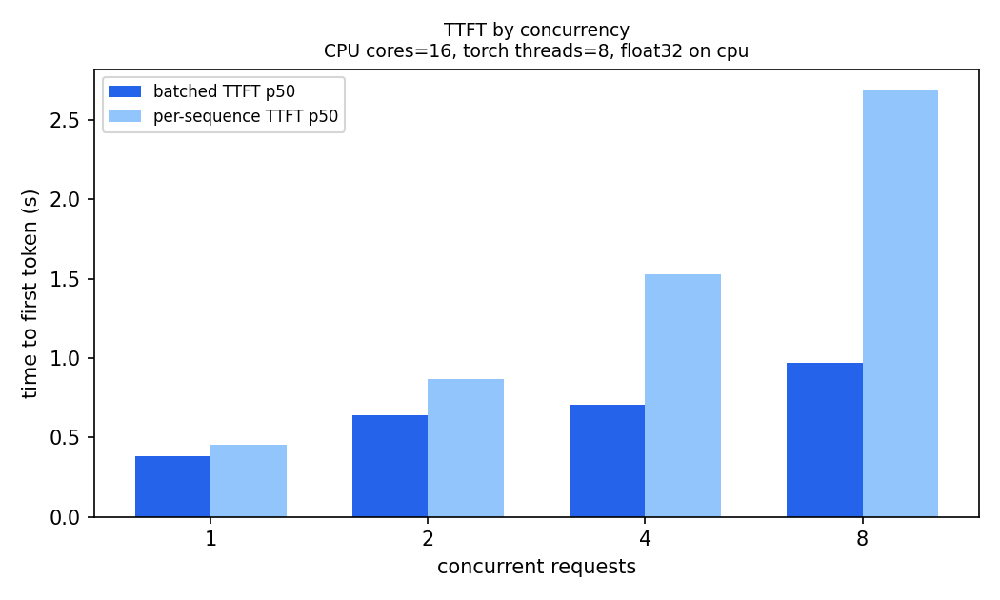

# Benchmarks

Reproducible throughput measurements for FluxLLM against a plain
`transformers` sequential baseline. Every number here comes from an actual
run whose raw artifacts are committed under `benchmarks/results/` — nothing
in this document is projected, extrapolated, or fabricated. If a number is
missing, that measurement has not been taken.

## Environment

Measured on the following machine (from the run's `env` snapshot,
`benchmarks/results/run_20261102T180750Z.json`):

| field | value |
| --- | --- |
| date (UTC) | 2026-11-02T18:07:50Z |
| platform | Windows-10, AMD64 (laptop, 8-core/16-thread Ryzen-class CPU) |
| logical CPUs / torch threads | 16 / 8 |
| Python / torch / transformers | 3.11.9 / 2.15.0+cpu / 5.22.1 |
| model | `Qwen/Qwen2.5-0.5B-Instruct` (Apache-2.0, ~1 GB) |
| precision / device | float32 / cpu (no CUDA on this machine) |
| code revision | `6350599874d218d8eb49306758db5b7fe357f926` |

## Methodology

Both modes decode the **same fixed prompt set** (8 varied short English
prompts, ~10–15 tokens each) with **greedy decoding** (`temperature=0`,
`top_k=1`, 32 `max_new_tokens` per request — 256 tokens total per run), so
the only difference between runs is how requests are scheduled:

- **Sequential baseline** — `transformers` `AutoModelForCausalLM.generate`,
  one request after another (the naive way to serve a fixed queue).
- **FluxLLM batched** — the continuous-batching engine at concurrency
  *c* ∈ {1, 2, 4, 8}. Each scheduler iteration groups every ready sequence
  into **one model forward** per phase (`prefill_batch` / `decode_batch`);
  attention still runs through the model's own kernel, not a paged-attention
  kernel.
- **FluxLLM per-sequence** — the same engine with
  `enable_batched_execution=False`, i.e. one decode forward per sequence.
  This is the pre-batching path and the controlled comparison for the
  batched numbers (same process, same prompt set, same run).
- A slot frees as soon as a request finishes, and the next queued request
  starts immediately (no batch drain). Each request streams through the
  engine's token events; TTFT and end-to-end latency come from the request's
  own timing checkpoints.
- Each mode runs one unmeasured warm-up request. Pool sizing (96 blocks ×
  16 tokens) was generous enough that **zero preemptions** occurred in any
  run, so these numbers measure scheduling and execution, not
  preemption/recompute churn.
- Executor-level prefix **compute** reuse is disabled for this comparison
  (`enable_prefix_compute_reuse=False`), so both paths cold-prefill every
  prompt and the only variable is batched vs per-sequence execution.

## Measured results

8 requests × 32 tokens each, per mode (`benchmarks/results/`):

| mode | decode path | concurrency | wall (s) | agg. throughput (tok/s) | TTFT p50 (s) | TTFT p95 (s) | e2e p50 (s) | preemptions |
| --- | --- | ---: | ---: | ---: | ---: | ---: | ---: | ---: |
| sequential transformers | — | 1 | 40.4 | 6.34 | — | — | 5.12 | — |
| fluxllm | batched | 1 | 37.0 | 6.92 | 0.38 | 0.54 | 4.58 | 0 |
| fluxllm | per-sequence | 1 | 47.5 | 5.38 | 0.45 | 0.62 | 5.92 | 0 |
| fluxllm | batched | 2 | 16.3 | **15.67** | 0.64 | 0.68 | 4.06 | 0 |
| fluxllm | per-sequence | 2 | 45.0 | 5.68 | 0.87 | 1.45 | 11.93 | 0 |
| fluxllm | batched | 4 | 20.1 | 12.74 | 0.71 | 0.71 | 10.34 | 0 |
| fluxllm | per-sequence | 4 | 42.0 | 6.10 | 1.53 | 2.39 | 21.10 | 0 |
| fluxllm | batched | 8 | 19.7 | 12.97 | 0.97 | 0.97 | 19.74 | 0 |
| fluxllm | per-sequence | 8 | 41.4 | 6.18 | 2.69 | 4.21 | 41.40 | 0 |




A second, identical run (`benchmarks/results/run_20261102T180013Z.json`)
showed the same shape: batched 15.74 / 12.07 / 12.34 tok/s at c = 2 / 4 / 8
versus 5.89 / 5.99 / 6.11 tok/s per-sequence. Run-to-run variance on this
laptop is roughly ±10%, which is why the controlled batched-vs-per-sequence
pairs — measured in the same process, minutes apart — matter more than the
absolute sequential baseline.

## Interpretation (honest read)

- **Batched decode is real and measured.** At c = 8, one forward across 8
  sequences reaches **12.97 tok/s vs 6.18 tok/s** on the per-sequence path
  (**2.10×**). At c = 2 the gap is **15.67 vs 5.68 tok/s (2.76×)**. The
  batched path is one model call per scheduler iteration, not *c* calls.
- **The best concurrency on this CPU is 2, not 8.** Throughput peaks at
  ~15.7 tok/s for c = 2 and plateaus at ~12.7–13.0 tok/s for c = 4–8. This
  executor still gathers each row's KV into a padded batch and slices it
  back out every step (Python loops plus per-row clones); beyond two rows,
  memory traffic and that gather/scatter overhead outweigh the extra
  parallelism. A fused paged-attention kernel is the next lever, and it is
  explicitly *not* claimed here.
- **TTFT improves because the iteration is shorter.** At c = 8, batched
  TTFT p50 is 0.97 s versus 2.69 s per-sequence: a ready sequence waits for
  one forward, not eight. End-to-end latency for 32 tokens drops from 41.4 s
  to 19.7 s at the same concurrency.
- **c = 1 is the engine-overhead check.** Batched c = 1 (6.92 tok/s) is
  within ~9% of the sequential `transformers` baseline (6.34 tok/s), and the
  per-sequence c = 1 run (5.38 tok/s) is within ~15%. These are single-run
  measurements with laptop thermal/background variance; no claim of a
  speedup over `generate` is made.
- **Continuous batching is still scheduler-level too.** Arrivals are
  admitted and prefilled while earlier requests are mid-decode (no
  wait-for-batch-drain), queue depth, batch size, and KV utilization are
  exposed live via `/stats` and Prometheus gauges, and completion/cancel
  paths free blocks immediately. That property is pinned down in
  `tests/unit/test_engine.py`
  (`test_later_arrivals_share_engine_iterations`).

## Prefix compute reuse

Executor-level prefix reuse is verified for correctness against the real
model in `tests/integration/test_hf_engine.py`:

- exact prompt match returns the stored next-token logits with **zero**
  forward work and matches a cold prefill's logits;
- a shorter cached prefix forwards only the uncached tail;
- a prompt that is a prefix of a cached longer prompt crops the cached KV
  and forwards one token;
- decoding after reuse matches decoding after a cold prefill token-for-token.

The engine exposes `fluxllm_prefix_compute_reuses_total` and
`fluxllm_prefix_compute_reused_tokens_total` so reuse is observable in
`/metrics`. A wall-clock benchmark for prefix reuse on repeated-prompt
traffic is not included in the numbers above; the table measures execution
batching only.

## What is *not* benchmarked (yet)

- Anything GPU/CUDA; this development machine has none, so no GPU numbers
  exist anywhere in this repo.
- Prefix-reuse wall-clock gains under repeated-prompt traffic (correctness
  and counters are verified; a dedicated throughput run is still to come).
- Paged-attention kernels, CUDA graphs, or speculative decoding: not
  implemented, never claimed.

## Reproduce

```bash
# ~8 minutes on the machine above (downloads ~1 GB of weights on first run)
python benchmarks/benchmark_throughput.py \
    --compare-batched --concurrency 1 2 4 8 --max-new-tokens 32 --warmup 1

# regenerate the PNG charts from the newest artifact
python scripts/make_charts.py
```

Artifacts land in `benchmarks/results/run_<UTC>.json` (with a full
environment snapshot and per-request timings) and
`summary_<UTC>.csv` (tight table matching the columns above). Include the
`commit_sha` from the JSON when reporting numbers elsewhere.
