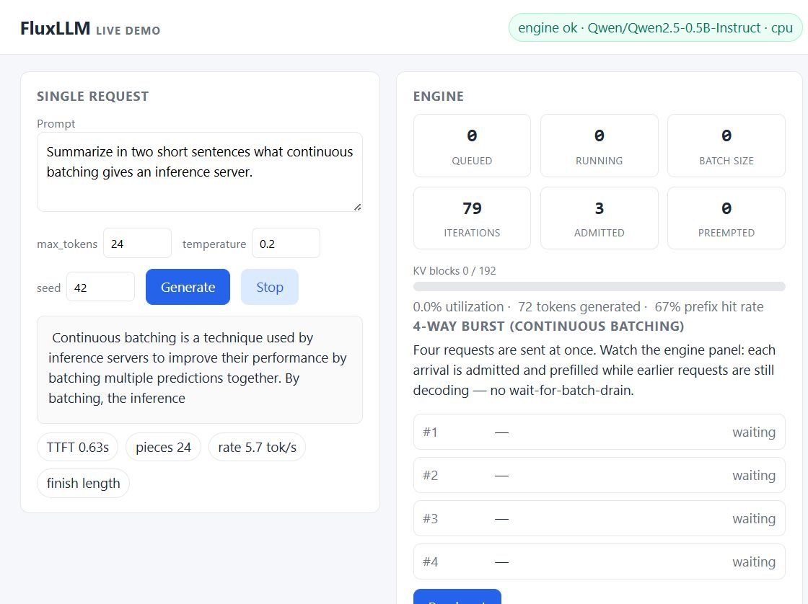

# FluxLLM

A high-throughput LLM inference engine built on PyTorch and Hugging Face
`transformers`, owning its own continuous-batching scheduler, block-based
KV-cache management, streaming, sampling, and metrics — deliberately no
vLLM/TGI/llama.cpp underneath. Built from scratch to understand what
inference engines actually do, with honest documentation of what each piece
does and does not do.



The screenshot is a live run: the demo page streams tokens from a real
`Qwen/Qwen2.5-0.5B-Instruct` (TTFT 0.63s, ~5.7 tok/s on CPU) while the
engine panel shows scheduler and KV-cache state pulled from `/stats` and
`/metrics`.

## What it does

- **Continuous batching** — a single async engine loop admits new requests
  while earlier requests are mid-decode (no wait-for-batch-drain), with
  strict-FIFO admission, per-iteration token budgets, and vLLM-style
  preemption + KV recompute under pool pressure.
- **Block-based KV-cache management** — sequences' KV entries are tracked in
  fixed-size logical blocks with refcounted ownership; capacity is checked
  *before* admission so the pool is never oversubscribed. A logical prefix
  cache reuses full prompt-prefix blocks across sequences via content-hash
  chains, and the executor reuses cloned KV snapshots for shared prompt
  prefixes so matching tokens are not recomputed.
- **Batched model execution** — ready sequences in a scheduler iteration are
  packed into one model forward per phase (`prefill_batch` / `decode_batch`)
  instead of one forward per sequence.
- **Streaming everywhere** — every generated token is an event on the
  request's stream, surfaced as OpenAI-style SSE over HTTP. An incremental
  detokenizer emits stable text deltas and holds back incomplete multi-byte
  characters, with client disconnects cancelling the server-side request.
- **OpenAI-compatible API** — `/v1/completions`, `/v1/chat/completions`
  (sync + streaming), `/health/live`, `/health/ready`, `/stats`, and
  Prometheus `/metrics`.
- **Sampling** — temperature / top-k / top-p / greedy with per-request
  seeds (numpy-based, reproducible).
- **Observability** — request lifecycle counters, TTFT / inter-token /
  e2e histograms, KV-utilization and queue-depth gauges, prefix-cache
  counters, live stats snapshot.
- **Reproducible benchmarks** — a benchmark harness comparing the engine
  against a plain `transformers` sequential baseline, writing JSON/CSV
  artifacts with full environment snapshots. Measured numbers (not
  projections) live in [BENCHMARKS.md](BENCHMARKS.md).

## Honest scope (what it is not)

This project optimizes for *understanding over pretending*:

- **Batched decode is model-forward batching, not a paged-attention
  kernel.** Ready sequences share one `model(...)` call with per-row KV
  gathered into a left-padded batch; attention still runs through
  `transformers`' own kernel. Measured on the CPU dev machine, that lifts
  aggregate throughput from 6.18 to 12.97 tok/s at concurrency 8 (2.1×) and
  peaks at 15.67 tok/s at concurrency 2; it does not scale linearly, because
  the gather/scatter and padding overhead grow with batch size. A fused
  paged-attention kernel remains future work, and nothing here claims vLLM
  PagedAttention parity.
- **Prefix reuse has two layers.** The block manager shares *capacity*
  (fewer blocks rented) and the executor shares *compute* (cloned KV
  snapshots let a prefill skip matching prompt tokens), but KV tensors are
  still per sequence, not paged. `ARCHITECTURE.md` spells out the
  difference.
- **The deterministic mode is a labeled simulation** (no real model
  output); it exists so tests and demos run in seconds without model
  downloads.
- **Benchmarks are environment-specific and measured, never projected.**
  Batched decode is a real, measured gain on this repo's CPU dev machine;
  the per-sequence path is still flat across concurrency, and the batched
  path plateaus beyond two rows. See [BENCHMARKS.md](BENCHMARKS.md) for the
  raw numbers, the controlled comparison, and methodology.

## Quickstart

Requires Python 3.11+.

```bash
pip install -e ".[api]"                 # engine + API only
pip install -e ".[api,torch]"           # engine + API + torch/transformers
```

### Serve the real model (CPU works)

```bash
uvicorn fluxllm.api.app:app --host 0.0.0.0 --port 8000
```

Generates with `Qwen/Qwen2.5-0.5B-Instruct` by default (~1 GB, Apache-2.0,
downloaded on first start into `HF_HOME`).

```bash
curl http://127.0.0.1:8000/v1/chat/completions \
  -H "Content-Type: application/json" \
  -d '{"messages":[{"role":"user","content":"Explain KV caching in one sentence."}],"max_tokens":32}'
```

### Streaming

```bash
curl -N http://127.0.0.1:8000/v1/chat/completions \
  -H "Content-Type: application/json" \
  -d '{"messages":[{"role":"user","content":"hello"}],"stream":true,"max_tokens":32}'
```

### Simulated mode (no model download, <2s startup)

```bash
FLUXLLM_DETERMINISTIC=1 uvicorn fluxllm.api.app:app --port 8000
```

Tokens are clearly labeled placeholders (`[sim n]`). This mode powers the
unit tests and the CI fast lane.

### Demo page

Open [`http://localhost:8000/demo/`](http://localhost:8000/demo/) —
streaming with visible TTFT, live engine gauges, and a 4-way burst that
shows arrivals joining mid-decode.

## Tests, lint, CI

```bash
pytest tests            # fast lane: no model download, no GPU
ruff check fluxllm tests
mypy fluxllm            # clean
```

CI (`ci.yml`) runs ruff + mypy + pytest-with-coverage + Docker builds on
every push. `model-integration.yml` runs the real-model integration tests
(`FLUXLLM_INTEGRATION=1`) weekly and on demand, so the fast lane never
downloads weights.

## Docker

```bash
docker build --target api -t fluxllm-api .
docker run --rm -p 8000:8000 fluxllm-api        # downloads weights into a volume
docker compose up                                # read-only rootfs, tmpfs, hf-cache volume
```

The `api` target ships CPU PyTorch, runs as a non-root user, and includes
a container healthcheck. Deployment guides (including Coolify) are in
[docs/deployment.md](docs/deployment.md).

## Project layout

```
fluxllm/
  engine/        async engine loop, request lifecycle, tokens
  executor/      ModelExecutor abstraction; HF (torch) + deterministic executor
  cache/         block manager + logical prefix cache
  scheduler/     admission policy + planning
  sampling/      numpy sampling (temperature/top-k/top-p/seeded)
  metrics/       Prometheus metrics, global registry
  api/           FastAPI routes/schemas, SSE, /demo mount
demo/            static demo page (single request + burst view)
benchmarks/      benchmark harness + measured results (JSON/CSV)
scripts/         chart generation from benchmark artifacts
tests/unit/      fast tests on the deterministic executor
tests/integration/  real-model tests (env-gated)
```

## Documentation

- [ARCHITECTURE.md](ARCHITECTURE.md) — module map, request lifecycle,
  scheduler contract, cache semantics, design decisions.
- [BENCHMARKS.md](BENCHMARKS.md) — methodology, measured results, honest
  interpretation, reproducibility.
- [ROADMAP.md](ROADMAP.md) — planned work (batched attention kernels,
  continuous-flow tuning).
- [SECURITY.md](SECURITY.md) — threat model and hardening.
- [CHANGELOG.md](CHANGELOG.md) — release history; every entry maps to real commits and committed artifacts.
- [docs/deployment.md](docs/deployment.md) — Docker, Compose, Coolify.

## License

Apache-2.0. No secrets, credentials, or model weights are stored in this
repository.
